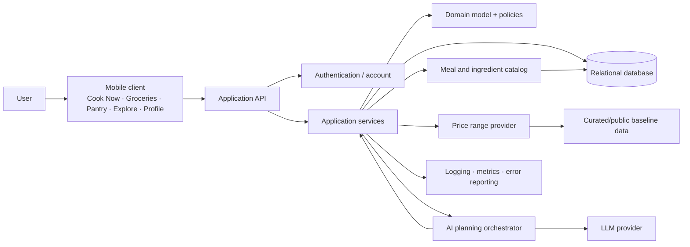
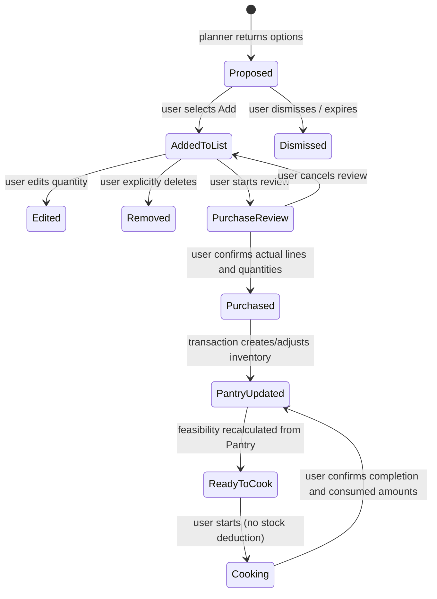

# Mise — Master System Design

**Status:** Proposed implementation blueprint · November 2026  
**Purpose:** Connect the product specifications to a domain model, code-level responsibilities, repository layout, dependencies, and a build sequence.

This document synthesizes the project guide, project description, screen specifications, discovery interview, and art direction, alongside the diagrams in `../Diagrams/`. It is an implementation blueprint; see `TECH_STACK.md` for the recommended concrete stack.

## Diagram gallery

These are standalone, editable SVG pictures. Open them individually for a clear full-size view.

1. [System architecture](../Diagrams/01-system-architecture.svg)
2. [Domain class model](../Diagrams/02-domain-class-model.svg)
3. [User state lifecycle](../Diagrams/03-user-state-lifecycle.svg)
4. [Proposed repository map](../Diagrams/04-repository-map.svg)

## 1. Product invariants the architecture must enforce

1. **Pantry is owned food.** Only confirmed purchases, manual inventory corrections, and confirmed cooking/consumption events change it.
2. **Groceries is intended food.** The open list is user editable. Suggestions are drafts until the user explicitly adds them. No assistant action silently removes an item.
3. **A meal suggestion is not a commitment.** Saved/discovered meals do not alter Groceries. Meal planning may explain a basket without creating a rigid schedule.
4. **Readiness uses Pantry only.** Active-list items may make a meal “supported after shopping,” but never “ready now.”
5. **Amounts have distinct meanings:** recipe requirement, usable Pantry contribution, shortfall, suggested purchase, and actual purchased amount. Do not collapse these into one quantity.
6. **Cooking changes stock only on confirmation.** Opening or starting a recipe does not deduct inventory. Leftovers are confirmed prepared food, stored separately from raw ingredients.
7. **Estimates remain estimates.** Price/nutrition values carry provenance and confidence when available. Do not claim exact checkout cost, actual spend, cheapest cart, or nutrition precision without supporting data.
8. **Deterministic code owns arithmetic and state changes.** An LLM can interpret and explain; domain services validate, calculate, and persist.
9. **Preferences guide unless marked strict.** Restrictions are hard constraints; goals and tastes rank or shape results without overriding the user's explicit choice.

## 2. System context and major dependencies



**Trust boundary:** The client submits commands and displays server state. The API authorizes the user, runs application use cases, and commits domain changes transactionally. The database is authoritative for each user's profile, list, Pantry, and events. AI and external data providers are optional/advisory dependencies; they do not own application state.

**Recommended MVP deployment shape:** one client app, one API/backend deployment, one relational database, and modular domain/application packages. Keep clear module boundaries without starting with microservices. A single backend transaction is important when confirming purchases or recording cooking so inventory and event history cannot drift apart.

**Technology-neutral decisions:** Choose client framework, server framework, database vendor, authentication provider, hosting, and AI vendor after inspecting existing implementation and team constraints. Prefer a relational store (e.g. PostgreSQL) because users, lists, items, meals, ingredient links, and event records have clear relations and transactional requirements. Keep provider-specific code behind interfaces.

## 3. Domain model

### 3.1 Bounded contexts

| Context | Owns | Must not own |
| --- | --- | --- |
| Identity & Profile | Account identity, household defaults, restrictions, flexible goals and preferences | Pantry/list state |
| Meal Catalog | Meals, versions, ingredients, instructions, nutrition/practical metadata, source/provenance | Per-user meal readiness |
| Discovery | Search, ranking, saved meals, user-facing rationale | Grocery mutations |
| Planning | Request interpretation, candidate selection, ingredient needs, overlap, coverage, proposed edits | Persistent list changes before approval |
| Groceries | One open list, consolidated editable items, links to supported meals, purchase review/confirmation | Owned stock before confirmation |
| Pantry | Raw inventory, prepared leftovers, locations, freshness estimates, adjustments | Intended purchases |
| Cooking | Cooking session and explicit completion/use confirmation | Inventory deductions before completion |
| Estimates | Price/nutrition estimate values, source, observed date, confidence | Actual spend claims absent evidence |

### 3.2 Domain entities and value objects

```mermaid
classDiagram
  class User {+UserId id}
  class Profile {+DietaryRule[] restrictions\n+Goal[] goals\n+TasteProfile tastes\n+CookingPreferences cooking\n+ShoppingDefaults shopping}
  class Meal {+MealId id\n+title\n+MealKind kind\n+MealIngredient[] ingredients\n+InstructionStep[] steps\n+MealMetadata metadata}
  class MealIngredient {+IngredientId ingredientId\n+Quantity required\n+bool optional}
  class Ingredient {+IngredientId id\n+canonicalName\n+UnitDimension dimension\n+SubstitutionGroup?}
  class Pantry {+PantryId id\n+InventoryEntry[] entries}
  class InventoryEntry {+EntryId id\n+IngredientId ingredientId\n+Quantity onHand\n+StorageLocation location\n+Date? freshnessEstimate\n+InventoryKind kind}
  class GroceryList {+ListId id\n+ListStatus status\n+GroceryItem[] items\n+SupportedMeal[] meals}
  class GroceryItem {+GroceryItemId id\n+IngredientId? ingredientId\n+Quantity plannedQuantity\n+PriceRange? estimate\n+bool pickedUp}
  class ProposedPlan {+ProposalId id\n+MealOption[] meals\n+ProposedAddition[] additions\n+Rationale rationale\n+expiresAt}
  class PurchaseConfirmation {+PurchaseId id\n+ConfirmedPurchaseLine[] lines\n+confirmedAt}
  class CookingRecord {+CookingId id\n+MealId mealId\n+int servings\n+ConsumedLine[] consumed\n+LeftoverLine[] leftovers\n+completedAt}
  class Estimate {+MoneyRange? price\n+NutritionEstimate? nutrition\n+source\n+asOf\n+confidence}
  User "1" --> "1" Profile
  User "1" --> "1" Pantry
  User "1" --> "1" GroceryList : one open list
  User "1" --> "0..*" CookingRecord
  User "1" --> "0..*" ProposedPlan
  GroceryList "1" --> "0..*" GroceryItem
  GroceryList "1" --> "0..*" SupportedMeal
  Meal "1" --> "1..*" MealIngredient
  MealIngredient "*" --> "1" Ingredient
  InventoryEntry "*" --> "1" Ingredient
  GroceryItem "0..*" --> "0..1" Ingredient
  PurchaseConfirmation "1" --> "1..*" ConfirmedPurchaseLine
  PurchaseConfirmation ..> Pantry : confirmed quantities add stock
  CookingRecord ..> Pantry : confirmed consumed quantities deduct stock
  Meal ..> Estimate
```



**Important modeling notes**

- Use stable canonical `IngredientId`s for matching catalog requirements, Pantry entries, and grocery lines. Keep the user's display label/notes where needed.
- Quantity is a value object (`amount`, `unit`, optional approximation flag). Unit conversion is allowed only within known compatible dimensions. Unknown conversions are unresolved, never silently guessed.
- `InventoryKind` distinguishes raw ingredient from prepared food. Prepared food can use estimated portions instead of exact mass.
- An open list is unique per user. Keep list items consolidated by canonical ingredient where possible; preserve arbitrary household items with a user-entered label and no forced meal relation.
- A meal can be user-created or catalog-provided; record ownership/source and versioning so edits do not mutate a shared catalog record.
- A price estimate includes range, currency, basis (e.g. baseline/package), source, `asOf`, and confidence. Actual purchase quantity is separate; actual price is optional.
- Persist important state transitions as auditable events (`PurchaseConfirmed`, `InventoryAdjusted`, `CookingCompleted`, `MealSaved`, `GroceryItemAdded/Edited/Removed`).

### 3.3 State machines and invariants



The `Purchased → PantryUpdated` transition should be one transaction with an idempotency key. A repeated confirmation request must not duplicate inventory. Meal readiness is derived from current Pantry plus meal requirements, not stored as an authoritative flag. “Almost There” is derived from a small, configurable missing-ingredient threshold; its precise default can be tuned without changing the ownership rule.

## 4. Code-level class boundaries and interactions

### 4.1 Application services and domain services

| Component | Responsibility | Depends on |
| --- | --- | --- |
| `CookNowQueryService` | Ready/Almost There and broader catalog query models | `MealSearch`, `FeasibilityService`, `RankingService`, repositories |
| `MealDetailQueryService` | Meal detail with ingredient status, steps, metadata | Catalog, Pantry query, feasibility |
| `ExploreQueryService` | Catalog search, filters, saved collection | Catalog/search, saved-meal repository, profile |
| `GroceryRequestService` | Build request context, call planner, return proposal; clear client input after submit | Profile, open list, Pantry snapshot, `MealPlanner` |
| `MealPlanner` | Select candidates, calculate scaled requirements, consolidate shared needs, explain tradeoffs | Catalog, `IngredientCalculator`, ranking, estimates |
| `IngredientCalculator` | Normalize units, scale servings, compute Pantry contribution and shortfall, consolidate list requirements | Ingredient/unit definitions |
| `ListCommandService` | Add approved proposal, quick add, edit, delete, update meal selection/servings | List repository, calculator, authorization |
| `PurchaseConfirmationService` | Validate reviewed lines and actual amounts; atomically record purchase and update Pantry | List, Pantry, event repositories, transaction manager |
| `PantryCommandService` | Manual add/edit/remove, consume/dispose, restock handoff | Pantry repo, list command service |
| `CookingService` | Start session; on explicit completion validate used amounts and leftovers then update Pantry | Meal, Pantry, event repositories |
| `ProfileService` | Read/update profile, distinguish strict rules from preferences | Profile repository |
| `PriceEstimateService` | Return sourced range or unavailable state | `PriceProvider` adapter |
| `NutritionEstimateService` | Return sourced estimates where data supports them | Nutrition provider/catalog values |
| `MealFeasibilityService` | Compute readiness solely against confirmed Pantry | Catalog, Pantry, calculator |
| `RecommendationRanker` | Rank valid options by request/profile fit, Pantry use, budget, time, variety | Feature data; never commits state |
| `AIRequestInterpreter` | Convert natural language to typed constraints and explain validated results | LLM provider interface, schemas |
| `PlanningOrchestrator` | Coordinate retrieval → calculation → validation → proposal | Interpreter, planner tools, domain services |

### 4.2 Core request flow

```mermaid
sequenceDiagram
  actor User
  participant UI as Groceries UI
  participant API
  participant Orch as PlanningOrchestrator
  participant Ctx as Context Queries
  participant LLM as LLM Adapter
  participant Planner as MealPlanner + Calculator
  participant DB
  User->>UI: Submit request text/voice
  UI->>API: POST planning request (idempotency key)
  API->>Ctx: Load profile + open list + Pantry snapshot
  Ctx->>DB: Read current state
  DB-->>Ctx: Snapshot
  Ctx-->>Orch: Typed context
  Orch->>LLM: Interpret request into constrained schema
  LLM-->>Orch: Intent / constraints (untrusted)
  Orch->>Planner: Retrieve candidates and calculate options
  Planner->>DB: Read catalog / ingredient mappings
  Planner-->>Orch: Validated proposal + estimate provenance
  Orch-->>API: Proposal (no list mutation)
  API-->>UI: Suggestion cards and Add actions
  UI->>UI: Clear request field; retain list and context
  User->>UI: Choose Add on proposal
  UI->>API: POST proposal approval
  API->>DB: Revalidate proposal and transactionally consolidate items
  DB-->>API: Updated list
  API-->>UI: Updated list + meal coverage
```

Treat model output as untrusted input: validate enum values, ingredient IDs, quantities, bounds, and policy constraints. If interpretation confidence is low or a strict restriction conflicts with the request, ask the user or present a clear unresolved state. The LLM must not call arbitrary persistence methods.

### 4.3 Purchase and cooking interactions

**Purchase:** User opens review → selects items actually bought → enters actual package/quantity (price optional) → backend validates ownership/list references → in one transaction writes confirmation, adds actual amounts to Pantry, updates/removes only the confirmed purchased quantities from the open list according to explicit UX policy, and emits an event → response includes Pantry changes. Define behavior for partial purchases; default: purchased line is reconciled, unbought amount remains on the open list until user removes it or marks it not bought.

**Cooking:** User opens/starts meal without stock mutation → confirms meal prepared and servings/amounts used → backend computes suggested consumption from recipe but asks for changed/as-written confirmation and allows correction → transaction deducts confirmed consumption and optionally adds separately typed prepared leftovers → readiness queries refresh.

## 5. API and persistence contracts

Example REST-shaped routes (names illustrative; keep commands explicit):

| Route | Intent | State change |
| --- | --- | --- |
| `GET /v1/cook-now` | Ready and Almost There query | No |
| `GET /v1/meals?query=&filters=` | Explore/search catalog | No |
| `GET /v1/meals/{mealId}` | Details plus Pantry status | No |
| `PUT /v1/meals/{mealId}/saved` | Save/unsave | Yes, saved relation only |
| `POST /v1/grocery-plans` | Interpret request and build proposal | No list mutation |
| `POST /v1/grocery-plans/{proposalId}/add` | Approve proposal additions | Yes, explicit user command |
| `GET /v1/grocery-list/open` | Read single open list and coverage | No |
| `POST/PATCH/DELETE /v1/grocery-list/items` | Quick add, edit, user delete | Yes |
| `POST /v1/grocery-list/purchase-confirmations` | Confirm actual items/amounts | Yes, atomically add to Pantry |
| `GET/POST/PATCH/DELETE /v1/pantry/items` | Read and manually maintain owned stock | Yes for commands |
| `POST /v1/pantry/items/{id}/restock` | Create editable grocery item | Yes, list only |
| `POST /v1/cooking-sessions` | Start cooking session | Session only; no inventory change |
| `POST /v1/cooking-sessions/{id}/complete` | Confirm consumption/leftovers | Yes, atomically update Pantry |
| `GET/PATCH /v1/profile` | Read/update preferences | Yes for patch |

Every user-scoped query/command must authorize against the authenticated user, not a client-supplied owner ID. Use optimistic concurrency (`version`/ETag) on list and Pantry edits to avoid lost updates. Use idempotency keys for purchase and cooking completion commands.

### Suggested relational tables

- `users`, `profiles`, `dietary_rules`, `goals`, `taste_preferences`, `equipment`, `shopping_defaults`
- `ingredients`, `ingredient_aliases`, `unit_conversions`, `substitution_groups`
- `meals`, `meal_versions`, `meal_ingredients`, `instruction_steps`, `meal_metadata`, `meal_estimates`
- `saved_meals`
- `pantries`, `inventory_entries`, `inventory_adjustments`
- `grocery_lists`, `grocery_items`, `grocery_item_meal_links`, `list_meal_selections`
- `planning_proposals`, `proposal_meals`, `proposal_additions` (may expire; do not treat as committed list state)
- `purchase_confirmations`, `purchase_lines`
- `cooking_sessions`, `cooking_records`, `consumption_lines`, `leftover_entries`
- `domain_events` or equivalent audit records; `estimate_sources`

Use foreign keys, uniqueness for one open list per user, check constraints for positive amounts, and timestamps. Keep raw source values/labels where a normalized value cannot be computed confidently.

## 6. Screen-to-domain mapping

| Screen / view | Query or command owner | Main data | Cross-context connection |
| --- | --- | --- | --- |
| Cook Now home | `CookNowQueryService` | Ready, Almost There, Pantry count, practical cues | Pantry + Meal Catalog + Profile ranking |
| Meal detail / cooking | `MealDetailQueryService`, `CookingService` | Requirements, availability, missing ingredients, instructions, metadata | Catalog + Pantry; explicit grocery handoff; confirmed completion updates Pantry |
| Explore / saved meals | `ExploreQueryService` | Broad catalog, filters, saved status | Catalog + Profile; save never adds Groceries |
| Groceries request | `GroceryRequestService` | Fresh prompt, request state, proposal cards | Current list + Pantry + Profile + Planning |
| Groceries list | `ListCommandService` / list query | Consolidated editable items, estimates, meal links | Planning + Pantry shortfall; user owns edits |
| Meals supported | Coverage query | Pantry/list/missing per ingredient | Catalog + current list + Pantry, with explicit state labels |
| Purchase review | `PurchaseConfirmationService` | Selected actual purchase lines/amounts | Groceries → Pantry, transactional |
| Pantry | `PantryCommandService` | Raw and prepared inventory, storage, freshness estimate | Purchase and cooking events; Cook Now and Grocery reads |
| Profile | `ProfileService` | Strict restrictions, flexible goals, tastes, defaults | Shared read context; only explicit profile edits change it |

The UI should reflect the art direction in `../Visual/ART_DIRECTION.md`: food-forward cards, warm palette, readable operational quantities, clear status labels in addition to color, and calm motion. Keep decorative elements outside domain state.

## 7. Proposed repository structure

The workspace has been organized into product/design areas. Application code has not been scaffolded yet. Keep the planning materials separate from app code; when implementation begins, add the following starter folders (the detailed file plan is in `TECH_STACK.md`).

```text
Mise/
├── Visual/                         # art direction, mood board, prototypes, app art
├── Diagrams/                       # architecture, domain, lifecycle, repo maps
├── Project Roadmap/                # project guide, screen specs, roadmap
├── Structure/                      # this design and recommended tech stack
├── Misc/                           # unclassified project material
├── app/                            # Expo Router route files
├── src/
│  ├── features/                    # Cook Now, Groceries, Pantry, Explore, Profile
│  ├── components/                  # reusable UI components
│  ├── domain/                      # quantities, readiness, lifecycle rules
│  ├── data/                        # sample catalog and database adapters
│  ├── services/                    # calls to protected backend functions
│  └── theme/                       # design tokens and visual system
├── assets/                         # app-ready artwork, icons, fonts
└── supabase/
   ├── migrations/                  # versioned database schema
   └── functions/                   # planning and confirmation operations
```

**Dependency rule:** `domain` depends on no UI, database vendor, Expo framework, or LLM SDK. Screens call feature services; server-side functions enforce protected operations. Ingredient calculations stay deterministic, and the server is the final authority for persisted state.
### External and internal dependencies

| Dependency | Needed for | Boundary / fallback |
| --- | --- | --- |
| Relational DB + migration tool | Shared authoritative state and transactions | Repository interfaces isolate vendor |
| Authentication provider | Identify user and protect data | `CurrentUser` abstraction; do not trust submitted user IDs |
| LLM provider | Optional natural-language parsing and explanation | `LLMClient` interface; typed schema validation; deterministic/manual request fallback |
| Catalog content | Search and meal planning | Curated seed/import pipeline with source/licensing metadata |
| Unit/ingredient reference | Ingredient matching and quantity calculations | Canonical IDs, explicit aliases, compatible-dimension conversions only |
| Price baseline | Indicative estimated ranges | `PriceProvider`; allow unavailable; source/date/confidence shown |
| Nutrition source | Supported nutrition estimates | `NutritionProvider`; missing values stay unknown |
| Voice-to-text (optional) | Grocery request input | Client OS/provider adapter; text input remains available |
| Logging/error monitoring | Operability and failure diagnosis | Do not log sensitive prompt/profile data by default |

No retailer, receipt OCR, barcode, or live sale integration is a required MVP dependency. Add only after validation and reliable authorized data access.

## 8. Implementation sequence

1. **Foundation:** choose stack, write ADRs, define ingredient/quantity/profile/list vocabulary, set up monorepo, authentication boundary, migrations, API contracts, error handling.
2. **Catalog + domain math:** canonical ingredient IDs/aliases, meal schema, curated seed data, quantity scaling, compatible unit conversion, pantry shortfall and readiness calculations.
3. **Pantry + Profile:** manual approximate inventory edits, storage and freshness estimates, strict-vs-flexible preferences, quick setup that does not gate discovery.
4. **Cook Now + Explore:** Pantry-only Ready/Almost There; broad search independent of Pantry; meal detail, saved meals, practical cues where data supports them.
5. **Groceries core:** one open list, quick add/edit/delete, meal-supported coverage, item↔meal links, Pantry contribution/shortfall; explicit user actions only.
6. **Planning proposals:** request context; catalog retrieval/ranking; shared ingredient consolidation; estimate ranges and provenance; proposal review and explicit Add. Introduce LLM interpretation behind a typed adapter only after deterministic planning contracts exist.
7. **Purchase confirmation:** partial purchase flow, actual purchased quantities, idempotent transaction into Pantry, list reconciliation behavior, audit history.
8. **Cooking completion:** cooking session without early deductions; user-confirmed consumption and optional prepared leftovers.
9. **Refine from research:** use interview evidence and usability observations to tune onboarding, ranking, price trust cues, Pantry burden, almost-there threshold, and whether Explore deserves a tab.

### Definition of done for the first complete loop

A user can find a meal from confirmed Pantry or browse any meal; ask Groceries for ideas using current context; inspect a proposal and its Pantry/list/missing quantities; explicitly add/edit/remove list items; confirm only what they bought and in what amount; see Pantry update; find newly feasible meals; and confirm cooking before stock changes. Every estimate is qualified and every state transition is explainable.

## 9. Cross-cutting requirements and unresolved design choices

- **Authorization/privacy:** isolate every row by authenticated user/household; decide household sharing before schema finalization.
- **Concurrency:** version open lists and Pantry; surface conflicts or refresh rather than overwriting newer edits.
- **Auditability:** retain purchase/cooking/manual adjustment records for correction and support, with deletion/retention policy defined.
- **Catalog quality:** define meal source, serving basis, ingredient aliases, optionality, nutrition source, and last review date.
- **Unknown data:** represent unknown cost, nutrition, freshness, unit conversion, or quantity explicitly; never coerce missing values to zero.
- **Accessibility:** text labels accompany color; controls work with screen readers and scalable text; voice input is optional.
- **Localization:** store canonical units and currency with explicit conversions; user-facing formatting follows locale.
- **Analytics:** measure task time, proposal add/edit/dismiss, list correction burden, readiness accuracy reports, and confidence; do not claim savings/waste reduction absent a credible baseline.
- **Research loop:** the discovery interview asks about recent behavior, not hypothetical enthusiasm. Keep observed evidence separate from assumptions and feature requests.

Decide before schema/API freeze: household/account sharing; exact partial-purchase reconciliation; inventory reservations (recommended none for MVP); event retention and account deletion; catalog licensing; proposal expiration/version rules; threshold for “Almost There”; supported units and package conventions; source requirements for estimate display.


